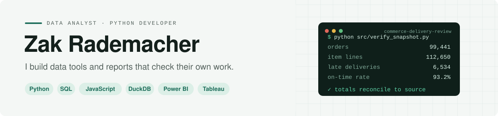
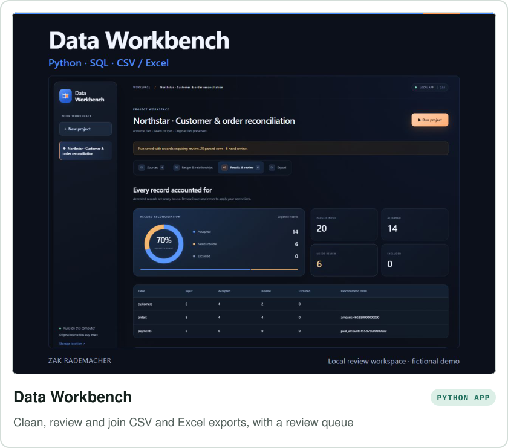
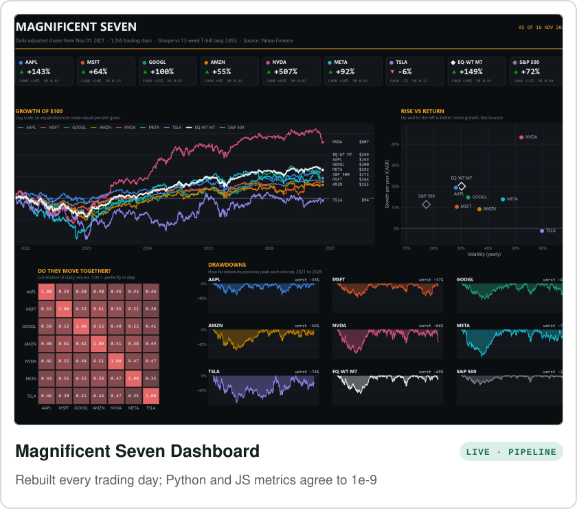
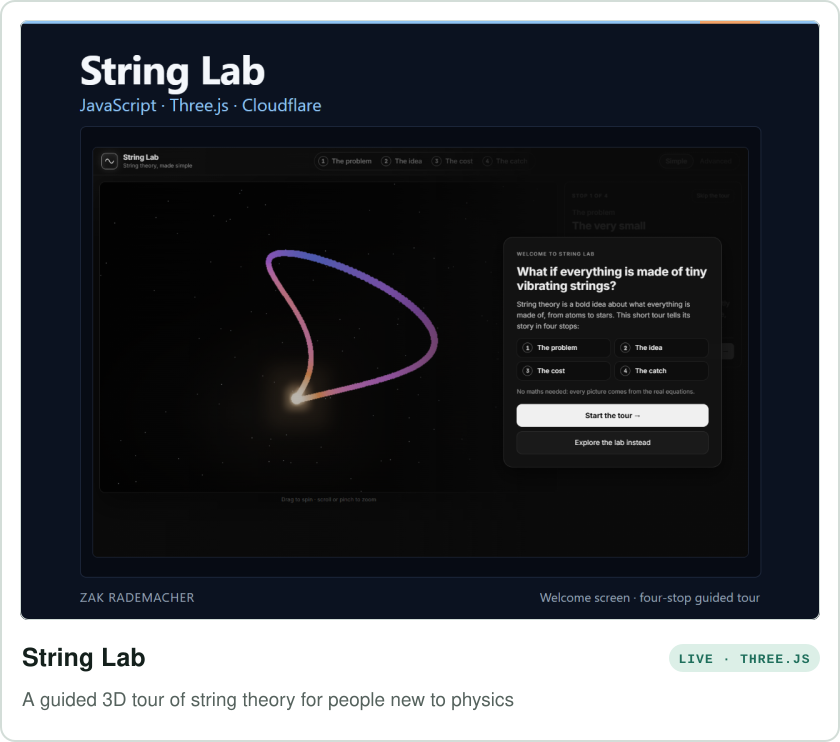
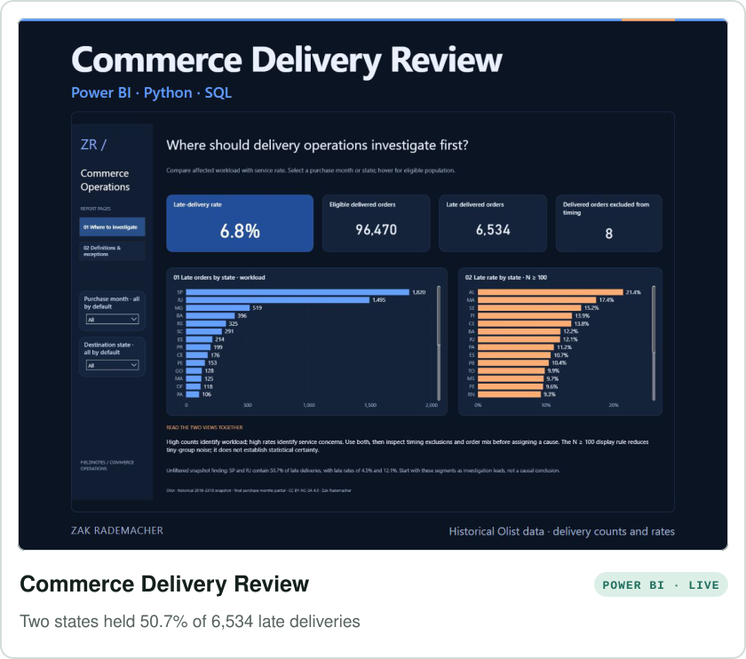
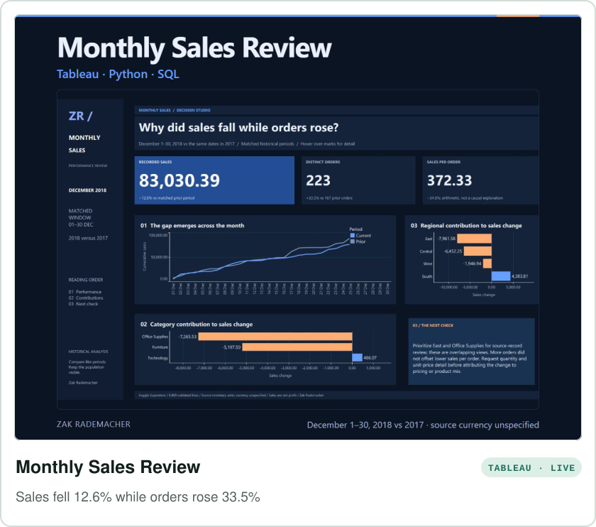
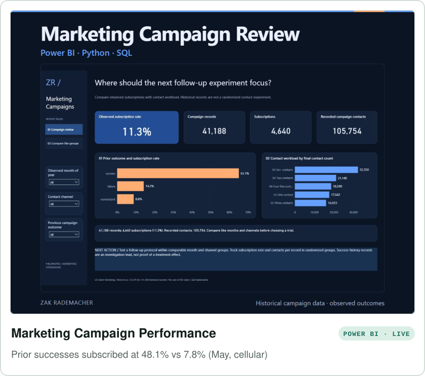

<picture>
  <source media="(prefers-color-scheme: dark)" srcset="assets/banner-dark.svg">
  
</picture>

**Data analyst and Python developer.** I build data tools and reporting pipelines with validated inputs, totals that reconcile, automated tests, and a live version you can open in the browser.

I supervise operations at a grocery store, so I build for the people who reconcile the numbers every day. Open to entry-level analyst and developer roles, and to 15–20 hours a week of remote project work on [Upwork](https://www.upwork.com/freelancers/~0155455f2cab08db17).

## Software

<table>
<tr>
<td width="50%" valign="top">

A local app that cleans and joins CSV and Excel exports, sends bad records to a review queue, and seals every run with a hash manifest.

<b>Python · FastAPI · DuckDB</b> <a href="https://github.com/ZakJRademacher/data-workbench">Code</a> · <a href="https://github.com/ZakJRademacher/data-workbench/blob/main/docs/TECHNICAL.md">Architecture</a>

</td>
<td width="50%" valign="top">

A 3D explorer of near-Earth asteroids from NASA and JPL data, with a Worker API and an interpolated 30-day path for each object.

<b>JavaScript · Three.js · Cloudflare Workers</b> <a href="https://perigee.zakjrademacher.workers.dev/"><b>Live</b></a> · <a href="https://github.com/ZakJRademacher/perigee-asteroid-tracker">Code</a> · <a href="https://github.com/ZakJRademacher/perigee-asteroid-tracker/blob/main/docs/METHODOLOGY.md">Method</a>

</td>
</tr>
<tr>
<td width="50%" valign="top">

A risk and return dashboard rebuilt every trading day by a scheduled pipeline. A test checks that the Python and browser metrics agree to within 1e-9.

<b>Python · pandas · GitHub Actions</b> <a href="https://zakjrademacher.github.io/magnificent-seven-dashboard/"><b>Live</b></a> · <a href="https://github.com/ZakJRademacher/magnificent-seven-dashboard">Code</a>

</td>
<td width="50%" valign="top">

A guided 3D introduction to string theory for people with no physics background, with an advanced lab for exploring further.

<b>JavaScript · Three.js · Vite</b> <a href="https://string-lab.zakjrademacher.workers.dev/"><b>Live</b></a> · <a href="https://github.com/ZakJRademacher/string-lab">Code</a>

</td>
</tr>
</table>

## Analysis and reporting

Each report is backed by a Python and SQLite pipeline with tests that run on every push. The native Power BI and Tableau files download from each project.

<table>
<tr>
<td width="50%" valign="top">

<b>Power BI · DAX · Python · SQLite</b> <a href="https://zakjrademacher.github.io/commerce-delivery-review/report/"><b>Live</b></a> · <a href="https://github.com/ZakJRademacher/commerce-delivery-review">Code</a> · <a href="https://github.com/ZakJRademacher/commerce-delivery-review/blob/main/docs/SQL_INVESTIGATION.md">SQL</a>

</td>
<td width="50%" valign="top">

<b>Tableau · Python · SQLite</b> <a href="https://zakjrademacher.github.io/monthly-sales-review/deliverables/Monthly%20Sales%20Interactive.html"><b>Live</b></a> · <a href="https://github.com/ZakJRademacher/monthly-sales-review">Code</a> · <a href="https://github.com/ZakJRademacher/monthly-sales-review/blob/main/sql/review_drivers.sql">SQL</a>

</td>
</tr>
<tr>
<td width="50%" valign="top">

<b>Tableau · Python · SQLite</b> <a href="https://zakjrademacher.github.io/hotel-booking-cancellation-analysis/report/"><b>Live</b></a> · <a href="https://github.com/ZakJRademacher/hotel-booking-cancellation-analysis">Code</a> · <a href="https://github.com/ZakJRademacher/hotel-booking-cancellation-analysis/blob/main/docs/DECISION_MEMO.md">Memo</a>

</td>
<td width="50%" valign="top">

<b>Power BI · DAX · Python · SQLite</b> <a href="https://zakjrademacher.github.io/marketing-campaign-performance/report/"><b>Live</b></a> · <a href="https://github.com/ZakJRademacher/marketing-campaign-performance">Code</a> · <a href="https://github.com/ZakJRademacher/marketing-campaign-performance/blob/main/docs/EXPERIMENT_PROPOSAL.md">Experiment</a>

</td>
</tr>
</table>

## How I work

- **Check the data before trusting it.** Inputs are validated, joins are tested for double counting, and totals reconcile to the source.
- **Make it repeatable.** Every project rebuilds from its inputs with one command, and tests run on every push.
- **Say what the data can't show.** Each report states its limits next to its findings.
