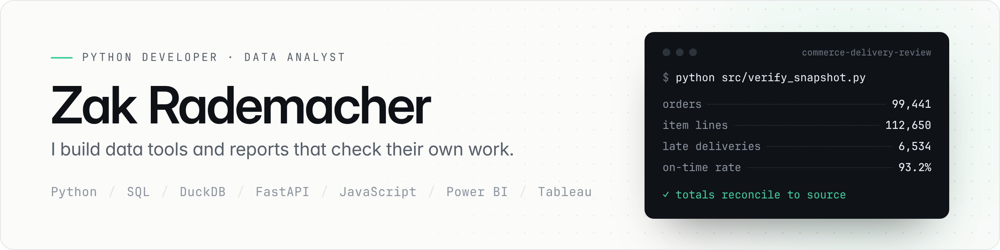
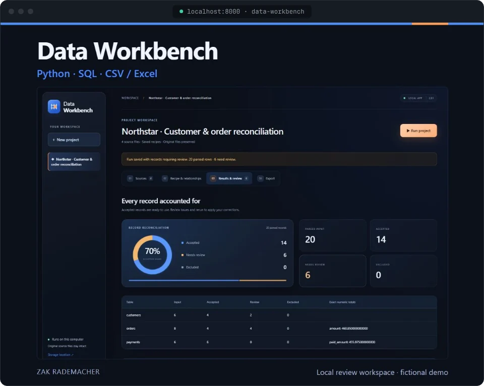
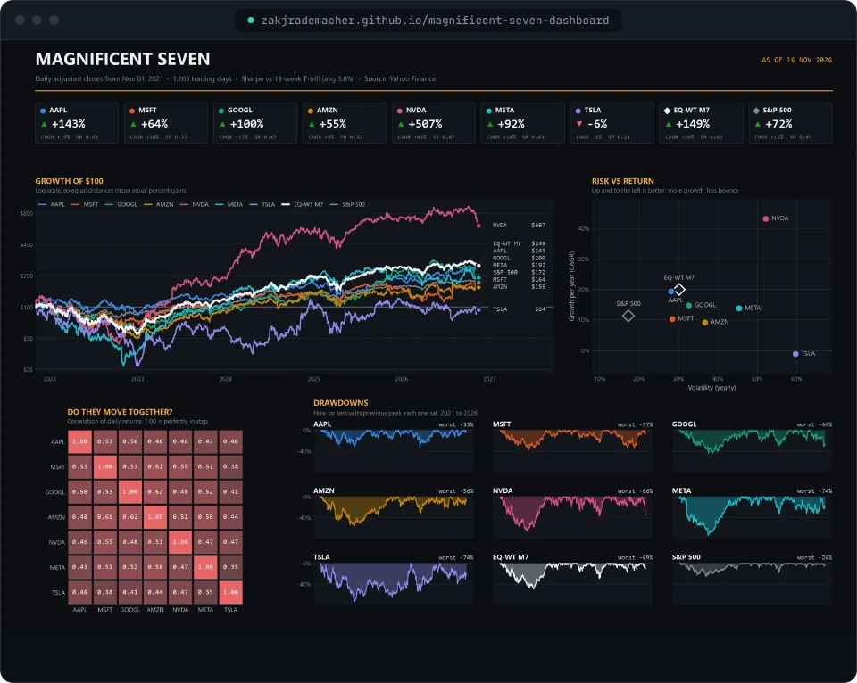
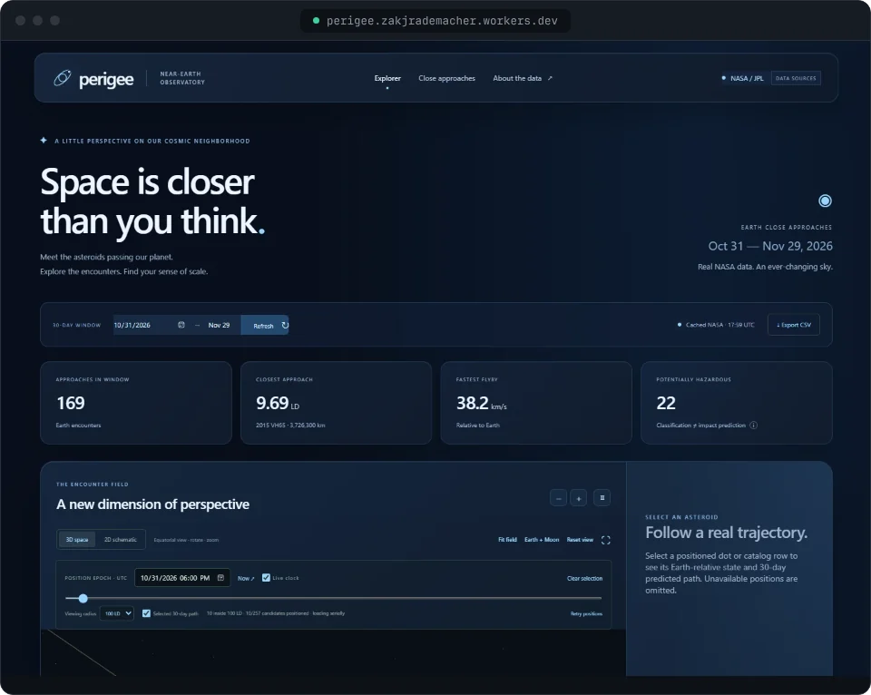
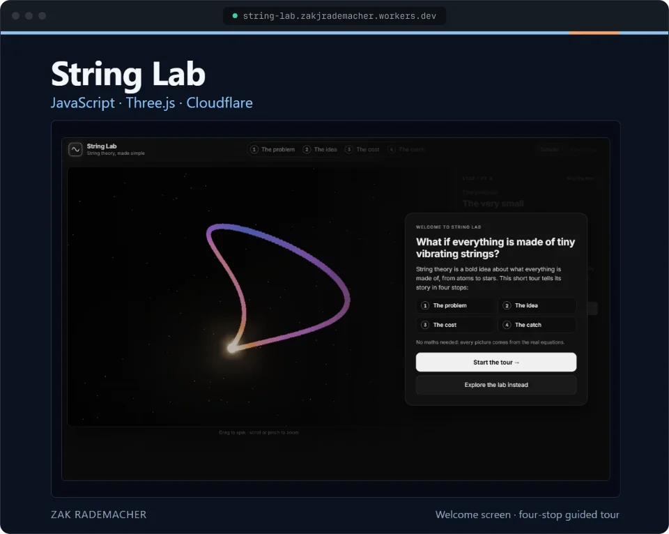
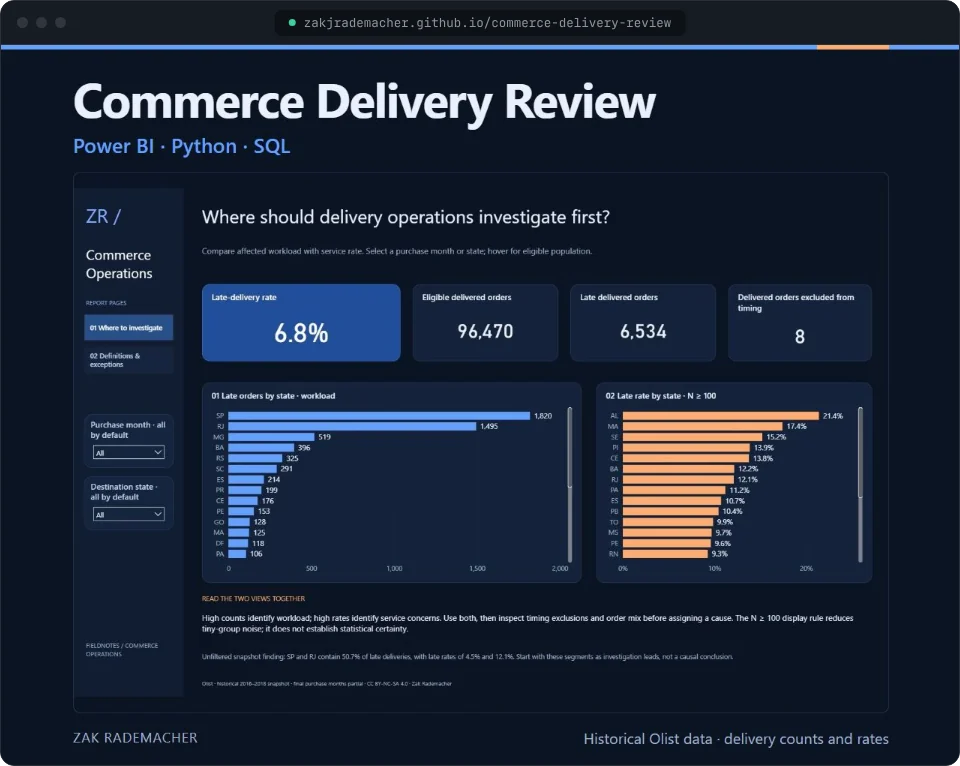
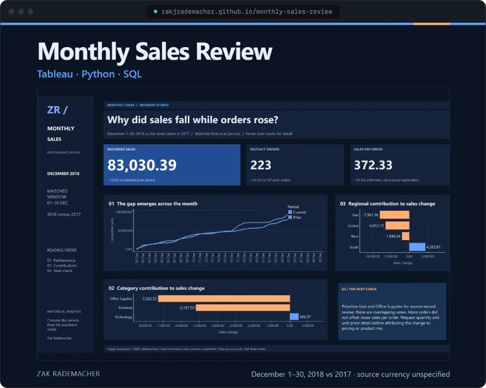
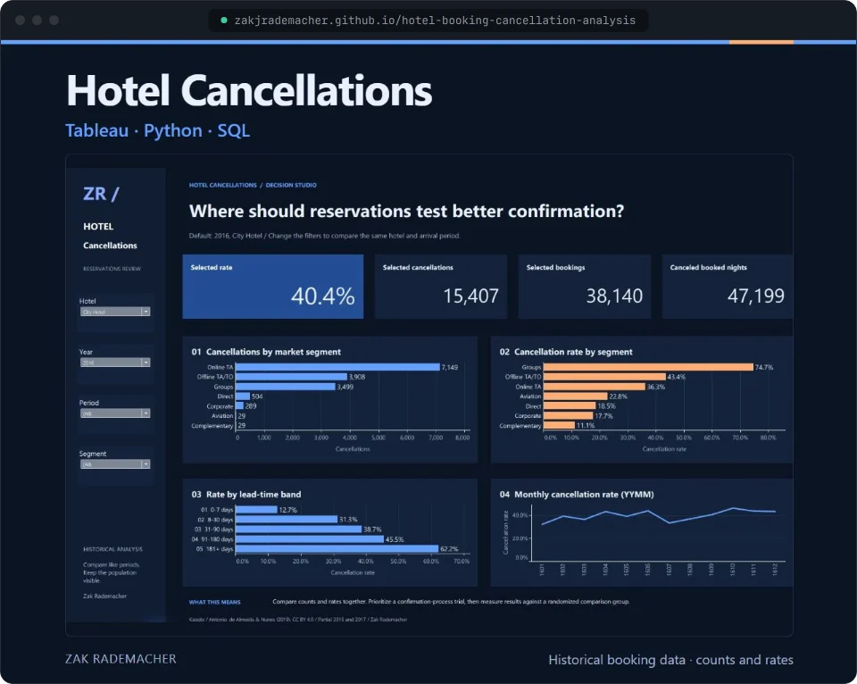
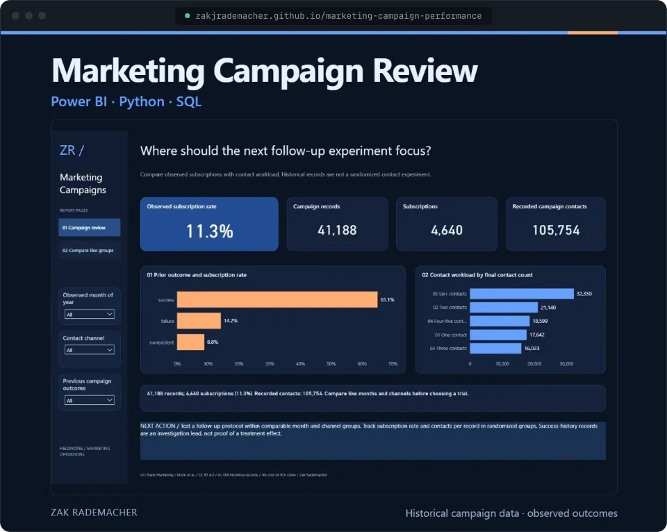

<picture>
  <source media="(prefers-color-scheme: dark)" srcset="assets/banner-dark.png">
  
</picture>

 

I build data tools and reporting pipelines that you can trust without re-checking: inputs are validated, totals reconcile to the source, tests run on every push, and there's a live version you can open in the browser.

My day job is running operations at a grocery store, where reconciling the numbers is part of every shift. I build for the people who do that work.

**Open to** analyst and developer roles, and 15–20 hrs/week of remote contract work via [Upwork](https://www.upwork.com/freelancers/~0155455f2cab08db17).

 

## Software

<table>
<tr>
<td width="50%" valign="top">

<h3><a href="https://github.com/ZakJRademacher/data-workbench">Data Workbench</a></h3>

A local app that cleans and joins CSV and Excel exports, sends bad records to a review queue, and seals every run with a hash manifest.

<code>Python</code> <code>FastAPI</code> <code>DuckDB</code>

<a href="https://github.com/ZakJRademacher/data-workbench">Code</a> · <a href="https://github.com/ZakJRademacher/data-workbench/blob/main/docs/TECHNICAL.md">Architecture</a>

</td>
<td width="50%" valign="top">

<h3><a href="https://zakjrademacher.github.io/magnificent-seven-dashboard/">Magnificent Seven Dashboard</a></h3>

A risk and return dashboard rebuilt every trading day by a scheduled pipeline. A test checks that the Python and browser metrics agree to within 1e-9.

<code>Python</code> <code>pandas</code> <code>GitHub Actions</code>

<a href="https://zakjrademacher.github.io/magnificent-seven-dashboard/"><b>Live ↗</b></a> · <a href="https://github.com/ZakJRademacher/magnificent-seven-dashboard">Code</a>

</td>
</tr>
<tr>
<td width="50%" valign="top">

<h3><a href="https://perigee.zakjrademacher.workers.dev/">Perigee</a></h3>

A 3D explorer of near-Earth asteroids from NASA and JPL data, with a Worker API and an interpolated 30-day path for each object.

<code>JavaScript</code> <code>Three.js</code> <code>Cloudflare Workers</code>

<a href="https://perigee.zakjrademacher.workers.dev/"><b>Live ↗</b></a> · <a href="https://github.com/ZakJRademacher/perigee-asteroid-tracker">Code</a> · <a href="https://github.com/ZakJRademacher/perigee-asteroid-tracker/blob/main/docs/METHODOLOGY.md">Method</a>

</td>
<td width="50%" valign="top">

<h3><a href="https://string-lab.zakjrademacher.workers.dev/">String Lab</a></h3>

A guided 3D introduction to string theory for people with no physics background, with an advanced lab for exploring further.

<code>JavaScript</code> <code>Three.js</code> <code>Vite</code>

<a href="https://string-lab.zakjrademacher.workers.dev/"><b>Live ↗</b></a> · <a href="https://github.com/ZakJRademacher/string-lab">Code</a>

</td>
</tr>
</table>

## Analysis & reporting

Each report is backed by a Python + SQLite pipeline with tests on every push. Native Power BI and Tableau files download from each repo.

<table>
<tr>
<td width="50%" valign="top">

<h3><a href="https://zakjrademacher.github.io/commerce-delivery-review/report/">Commerce Delivery Review</a></h3>

Two states held <b>50.7%</b> of 6,534 late deliveries, so that's where operations should look first.

<code>Power BI</code> <code>DAX</code> <code>Python</code> <code>SQLite</code>

<a href="https://zakjrademacher.github.io/commerce-delivery-review/report/"><b>Live ↗</b></a> · <a href="https://github.com/ZakJRademacher/commerce-delivery-review">Code</a> · <a href="https://github.com/ZakJRademacher/commerce-delivery-review/blob/main/docs/SQL_INVESTIGATION.md">SQL</a>

</td>
<td width="50%" valign="top">

<h3><a href="https://zakjrademacher.github.io/monthly-sales-review/deliverables/Monthly%20Sales%20Interactive.html">Monthly Sales Review</a></h3>

Sales fell <b>12.6%</b> while orders rose <b>33.5%</b>. The review traces the gap by region and category.

<code>Tableau</code> <code>Python</code> <code>SQLite</code>

<a href="https://zakjrademacher.github.io/monthly-sales-review/deliverables/Monthly%20Sales%20Interactive.html"><b>Live ↗</b></a> · <a href="https://github.com/ZakJRademacher/monthly-sales-review">Code</a> · <a href="https://github.com/ZakJRademacher/monthly-sales-review/blob/main/sql/review_drivers.sql">SQL</a>

</td>
</tr>
<tr>
<td width="50%" valign="top">

<h3><a href="https://zakjrademacher.github.io/hotel-booking-cancellation-analysis/report/">Hotel Booking Cancellations</a></h3>

Group bookings cancelled at <b>74.7%</b> (City Hotel, 2016), with a memo on where to test better confirmation.

<code>Tableau</code> <code>Python</code> <code>SQLite</code>

<a href="https://zakjrademacher.github.io/hotel-booking-cancellation-analysis/report/"><b>Live ↗</b></a> · <a href="https://github.com/ZakJRademacher/hotel-booking-cancellation-analysis">Code</a> · <a href="https://github.com/ZakJRademacher/hotel-booking-cancellation-analysis/blob/main/docs/DECISION_MEMO.md">Memo</a>

</td>
<td width="50%" valign="top">

<h3><a href="https://zakjrademacher.github.io/marketing-campaign-performance/report/">Marketing Campaign Performance</a></h3>

Prior successes subscribed at <b>48.1%</b> vs 7.8%, with a proposed follow-up experiment to test it.

<code>Power BI</code> <code>DAX</code> <code>Python</code> <code>SQLite</code>

<a href="https://zakjrademacher.github.io/marketing-campaign-performance/report/"><b>Live ↗</b></a> · <a href="https://github.com/ZakJRademacher/marketing-campaign-performance">Code</a> · <a href="https://github.com/ZakJRademacher/marketing-campaign-performance/blob/main/docs/EXPERIMENT_PROPOSAL.md">Experiment</a>

</td>
</tr>
</table>

## How I work

**Check the data before trusting it.** Inputs are validated, joins are tested for double counting, and totals reconcile to the source. 
**Make it repeatable.** Every project rebuilds from its inputs with one command, and tests run on every push. 
**Say what the data can't show.** Each report states its limits next to its findings.

 

<a href="https://www.upwork.com/freelancers/~0155455f2cab08db17">Hire me on Upwork</a> · <a href="https://github.com/ZakJRademacher?tab=repositories">All repositories</a>

