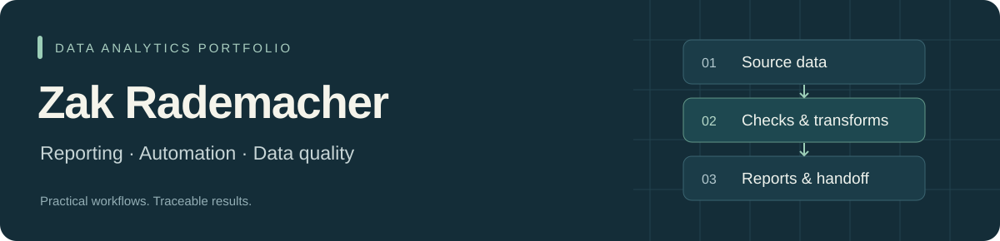

I focus on **data analysis and business reporting with Python, SQL, Excel, Power Query and Power BI**: prepare reliable data, investigate performance changes and explain the findings in a usable report.

I work as an Operations Supervisor at **Safeway** and bring an operations perspective to the questions, metrics and follow-up actions.

Available for **15–20 hours of remote project work per week**. [Work with me on Upwork](https://www.upwork.com/freelancers/~0155455f2cab08db17).

### Tools used in these projects

  

## Selected work

Start with a business question, then inspect the analysis, data preparation and supporting checks. These four projects have distinct roles.

<table>
<tr>
<td width="50%" valign="top">
<h3><a href="https://github.com/ZakJRademacher/monthly-sales-automation">Monthly Sales Review</a></h3>

Why did sales fall while order counts rose? A matched-period analysis with category, regional and product follow-ups.

<strong>9,800 historical lines</strong> across 48 monthly files, validated with Python and SQL.

Tableau · Python · SQLite

<a href="https://github.com/ZakJRademacher/monthly-sales-automation/blob/main/deliverables/tableau-sales-preview.png">Preview the report →</a> · <a href="https://github.com/ZakJRademacher/monthly-sales-automation">Source &amp; method</a>

</td>
<td width="50%" valign="top">
<h3><a href="https://github.com/ZakJRademacher/commerce-operations-powerbi">Commerce Operations</a></h3>

Where should operations investigate late deliveries? Compare affected volume with service rates using separate order/item facts.

<strong>99,441 historical orders</strong> with documented grains, measures and source limitations.

Power BI · DAX · Python · SQLite

<a href="https://github.com/ZakJRademacher/commerce-operations-powerbi/blob/main/deliverables/Commerce%20Delivery%20Priorities.pbix">Download the report →</a> · <a href="https://github.com/ZakJRademacher/commerce-operations-powerbi">Source &amp; method</a>

</td>
</tr>
<tr>
<td width="50%" valign="top">
<h3><a href="https://github.com/ZakJRademacher/excel-export-consolidator">Excel Export Consolidator</a></h3>

Prepare recurring business exports for analysis: one refreshable master, a correction queue and source traceability.

<strong>309 inputs</strong> reconciled into accepted records, corrections and skipped repeats.

Excel · Power Query

<a href="https://github.com/ZakJRademacher/excel-export-consolidator/blob/main/deliverables/Export%20Consolidator.xlsx">Open the workbook →</a> · <a href="https://github.com/ZakJRademacher/excel-export-consolidator">Source &amp; method</a>

</td>
<td width="50%" valign="top">
<h3><a href="https://github.com/ZakJRademacher/retail-sales-data-quality">Retail Data Quality Audit</a></h3>

How do cleaning decisions change reported sales? Preserve valid sales, distinguish cancellations and quantify duplicate sensitivity.

<strong>541,909 historical transaction lines</strong> with documented assumptions and exact monetary reconciliation.

Tableau · Python · SQL · Excel

<a href="https://github.com/ZakJRademacher/retail-sales-data-quality/blob/main/deliverables/tableau-retail-preview.png">Read the findings →</a> · <a href="https://github.com/ZakJRademacher/retail-sales-data-quality">Source &amp; method</a>

</td>
</tr>
</table>

The Tableau briefs are shown as previews; their workbook files remain local. Power BI downloads include imported historical data.

## Supporting workflows

| Project | What to inspect |
| --- | --- |
| [CSV Workbench & Cloud Intake](https://github.com/ZakJRademacher/cloud-file-intake) | Configurable local CSV preparation and validation; a separate AWS pipeline demonstrates ingestion and replay. Supporting engineering work, with local/cloud contracts documented. |
| [Complaint Intake Operations](https://github.com/ZakJRademacher/complaint-intake-operations) | SQL percentile reporting and a repeatable exception-review workflow that preserves reviewer notes by complaint ID. |

## Additional technical project

[**Perigee · NASA/JPL Explorer**](https://perigee.zakjrademacher.workers.dev/) — an interactive scientific-data visualization with timestamped positions, API integrations and documented coordinate checks. [Source & method](https://github.com/ZakJRademacher/perigee-asteroid-tracker).

## How I approach the work

- **Define the metric:** identify the row grain, valid population and exceptions before comparing totals.
- **Make it traceable:** preserve source references, reconciliation checks and rerun instructions.
- **Deliver something usable:** provide the report, a review queue where needed, and a practical handoff.

My background combines day-to-day operations supervision with computer-science college coursework and ongoing Python and SQL study. Tableau is a planned learning goal; a Tableau deliverable is not yet included in this portfolio. These are independent portfolio demonstrations using attributed public or fictional data; each repository documents its sources, scope and limitations.

