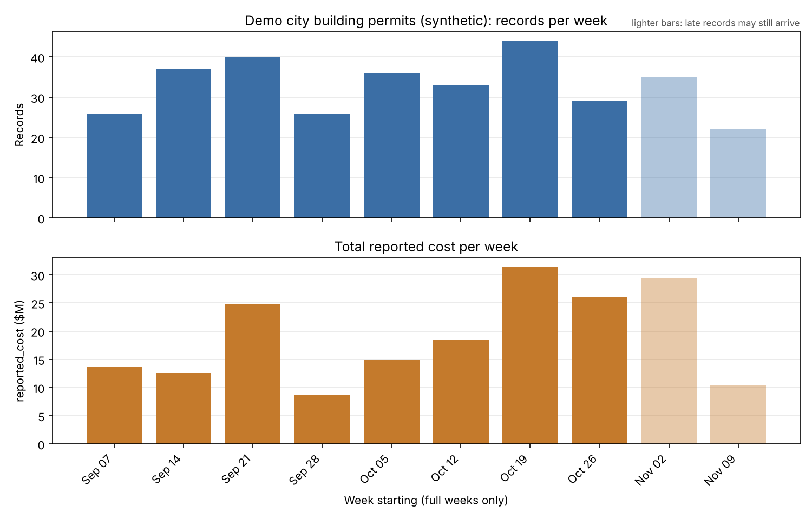

# Permits Feed

Pulls new building permits from a city's open-data portal every week and turns them into a clean spreadsheet: what's new since last week, totals by permit type and neighborhood, and the full history. It's set up for Chicago, and it works with any portal that runs on Socrata (NYC, San Francisco, Seattle, Austin, Los Angeles and many counties and states). To switch portals, you edit a config file, not the code.



<sub>Sample output from `scripts/demo.py`: 11 weekly runs against a simulated portal with **synthetic** permits shaped like Chicago's. Lighter bars are recent weeks that may still receive late-posted permits.</sub>

## Who it's for

Contractors, suppliers, roofers, architects and real-estate analysts who want a weekly list of new jobs in their area, for example "every permit over $50,000 issued in my city this week, with the address and a description of the work."

## What it does

- **Pulls only what's new.** Each run asks the portal for recent records, using the city's official API with paging, and stores them in SQLite. A record that was already seen isn't reported again.
- **Catches late and corrected records.** Portals often post permits days after they're issued, and sometimes correct them later. Each run re-checks the last 14 days (you can change this). Late arrivals are reported as new, and corrected records are counted as updates and saved with the new values.
- **Checks the schema before trusting the data.** If the city renames or drops a field, the run stops and lists the fields that do exist. It doesn't quietly fill your spreadsheet with blanks.
- **Doesn't keep half a run.** If the portal fails partway through, nothing from that run is saved, and the next run fetches the same window again.
- **Shows what it couldn't read.** A value that doesn't fit its column, such as a ward of `4.5`, is left blank and counted in the run log, rather than guessed.
- **Stores only the fields you list.** Owner and contact names are never requested, so personal data never enters the database or the reports.

## Output

Each run writes a workbook named after the dataset and the run date, for example [`demo-permits_2026-11-16.xlsx`](sample_output/demo-permits_2026-11-16.xlsx):

| Sheet | Contents |
|---|---|
| `new_this_run` | Records first seen in this run, newest first, with a full street address |
| `by_permit_type` | New records per permit type: count, total and median reported cost |
| `by_community_area` | The same, by community area |
| `all_records` | Everything collected so far, with the run each record was first seen and last changed |
| `runs` | One row per run: date window, rows fetched, new, updated, unreadable values, status, error |

The run also writes [`new_records.csv`](sample_output/new_records.csv), [`all_records.csv`](sample_output/all_records.csv), the chart above and the SQLite database.

The run log from the demo shows the 14-day re-check at work: each run fetches more rows than are new, which is how it catches late postings and corrections.

```
run date    window from  fetched  new  updated  unreadable
2026-11-02  2026-10-11       99   31        2           1
2026-11-09  2026-10-18       99   35        1           1
2026-11-16  2026-10-26       88   33        2           3
```

## How to run it

Requires Python 3.11 or newer.

```bash
pip install -r requirements.txt

# Fetch new permits and write the spreadsheet, CSVs and chart
python -m permits_feed run --report-dir reports

# Rebuild the reports from the database without fetching
python -m permits_feed report --out reports

# Regenerate sample_output/ from the simulated portal
python scripts/demo.py
```

The first run fetches from `start_date`. Later runs pick up where the last one stopped.

An app token is optional, but it raises the portal's rate limit. Create one free on the portal, then set `SOCRATA_APP_TOKEN` in your environment.

### Point it at another city

1. Find the dataset on the portal. The id is the `xxxx-xxxx` code in its URL.
2. List its fields: `python -m permits_feed fields --domain data.cityofnewyork.us --dataset <id>`
3. Copy `permits.toml`, then set `[source]` and map the columns you want in `[fields]`.

```toml
[source]
name = "Chicago building permits"
domain = "data.cityofchicago.org"
dataset = "ydr8-5enu"
id_field = "id"
date_field = "issue_date"
start_date = "2026-09-01"
lookback_days = 14
where = "reported_cost >= 50000"   # optional filter, run by the portal (SoQL)

[fields]            # output column = source field; only these are stored
permit_number = "permit_"
reported_cost = "reported_cost"
# ...

[types]             # date, money, int, float or text
reported_cost = "money"
```

The same setup works for other record types on these portals, such as business licenses, government bids and contracts, or code violations.

### Run it weekly

[`.github/workflows/weekly.yml`](.github/workflows/weekly.yml) runs the feed every Monday on GitHub Actions and commits the database and the new spreadsheet back to the repository. Locally, a cron entry works too:

```
17 13 * * 1  cd /path/to/permits-feed && python -m permits_feed run --report-dir reports
```

## Tests

```bash
pip install -r requirements-dev.txt
python -m pytest
```

The 27 tests run against a local fake Socrata portal and synthetic permits. They cover:

- **Paging:** more than one page of results, in a stable order.
- **Weekly runs:** five runs that miss nothing and count nothing twice, including late-posted and corrected records.
- **Personal data:** owner names never reach the database.
- **Bad data:** unreadable values are counted and left blank.
- **Failures:** a renamed field stops the run with a clear message, and a failed run leaves no partial data.
- **Config:** invalid settings are rejected.
- **Reports:** every sheet and file is written.

## Limits

- **Chicago's field names haven't been checked against the live portal yet.** The defaults in `permits.toml` were written without access to it. The schema check will stop the first run and list the real fields if any name is wrong, and `fields` prints them too.
- **Only the lookback window is re-checked.** A correction to a record older than `lookback_days` is not picked up.
- **Only Socrata portals are supported.** Portals on ArcGIS or CKAN need a different client. The storage, cleaning and reports would carry over.
- **Data is as published.** Reported cost is the applicant's estimate, and some cities post permits days or weeks late.

## Layout

```
permits_feed/
  config.py   feed definition (TOML) and validation
  socrata.py  API client: schema check, paging, retries, app token
  clean.py    typed cleaning of dates, money and numbers
  store.py    SQLite records and run log
  feed.py     one run: window, query, clean, save new and changed records
  report.py   weekly workbook, CSVs and chart
  cli.py      run / report / fields commands
scripts/demo.py   runs the feed weekly against the simulated portal
tests/            pytest suite, fake Socrata portal, synthetic permits
```
