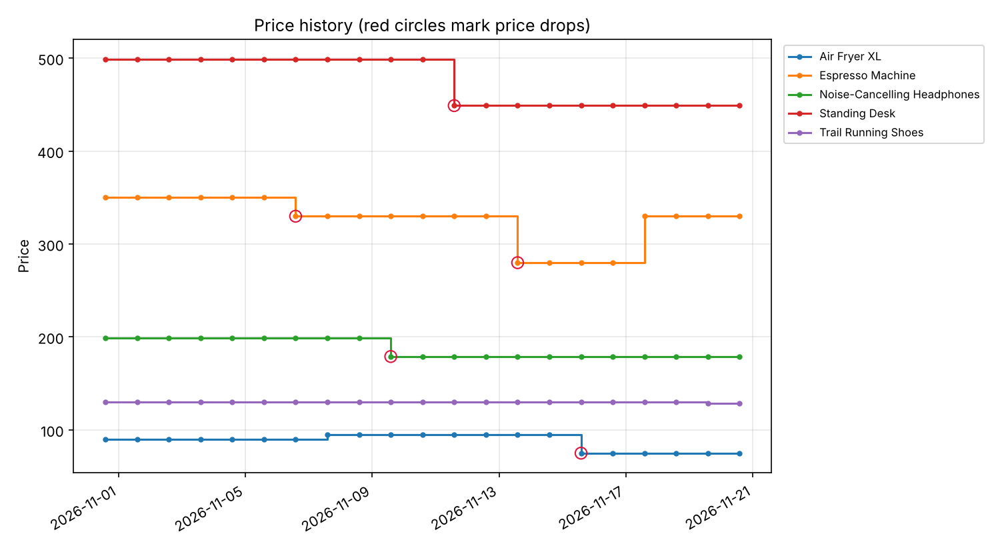

# Price Monitor

Tracks prices and stock status on a list of public product pages, keeps the full history in SQLite, and flags price drops, restocks and target prices. Each run can export a CSV, an Excel workbook and a chart.



<sub>Sample output from `scripts/demo.py`: 21 daily checks of a simulated store. Red circles mark the drops the monitor flagged.</sub>

## What it does

- **Reads most stores without custom code.** It finds the price in the schema.org product data (JSON-LD) that stores publish for Google, then falls back to product meta tags and microdata. A store with none of these needs one short adapter function. See `books.toscrape.com` in [`extract.py`](price_monitor/extract.py) for an example.
- **Flags what changed** since the last check: `price_drop` (above a threshold you set, 1% by default), `price_rise`, `out_of_stock`, `back_in_stock`, and `target_hit` the first time a price reaches your target.
- **Keeps every check.** Prices are stored as integer cents in SQLite, so comparisons are exact. Failed checks are recorded with the error rather than silently skipped.
- **Keeps going when a page breaks.** One page that fails or changes layout doesn't stop the run. The run summary lists it, and the command exits non-zero only if every page failed, so a scheduler can alert you.
- **Scrapes politely.** It checks robots.txt, waits between requests to the same site, retries with backoff on 429 and 5xx responses (honoring `Retry-After`), caches pages, and sends an honest user-agent.

## Output

| File | Contents |
|---|---|
| [`latest.csv`](sample_output/latest.csv) | One row per product: current price, stock, lowest and highest seen, target, last checked, last error |
| [`events.csv`](sample_output/events.csv) | Every drop, rise, restock and target hit, newest first, with the % change |
| [`history.csv`](sample_output/history.csv) | Every check, including failed ones and why they failed |
| [`price_report.xlsx`](sample_output/price_report.xlsx) | The three tables above as sheets, with frozen headers and sized columns |
| [`price_history.png`](sample_output/price_history.png) | Step chart of each product's price, with drops circled |
| [`prices.db`](sample_output/prices.db) | The SQLite database (`products`, `observations`, `events`) |

Sample `events.csv`:

```
observed_at,product,kind,old_price,new_price,pct_change
2026-11-15T14:00:00+00:00,Air Fryer XL,price_drop,94.99,74.99,-21.05
2026-11-13T14:00:00+00:00,Espresso Machine,price_drop,329.99,279.99,-15.15
2026-11-11T14:00:00+00:00,Standing Desk,target_hit,450.00,449.00,
2026-11-09T14:00:00+00:00,Noise-Cancelling Headphones,back_in_stock,,,
```

## How to run it

Requires Python 3.11 or newer.

```bash
pip install -r requirements.txt

# 1. List the pages to watch in products.toml
# 2. Check them all once, and export reports
python -m price_monitor run --report-dir reports

# Run it again later (or daily, see below) to build history and catch changes
python -m price_monitor run --report-dir reports
```

Example run output:

```
Checked 5 products at 2026-11-11T14:00:00+00:00: 5 ok, 0 failed
  PRICE DROP     Standing Desk: 499.00 -> 449.00 (-10.0%)
  TARGET HIT     Standing Desk: 450.00 -> 449.00
```

Other commands:

```bash
# Test a single page before adding it (it shows which extractor found the price)
python -m price_monitor check https://books.toscrape.com/catalogue/a-light-in-the-attic_1000/index.html

# Re-export reports from the database without scraping
python -m price_monitor report --out reports

# Regenerate sample_output/ from the simulated store
python scripts/demo.py
```

### The watch list

```toml
[settings]
delay_seconds = 3.0        # minimum wait between requests to the same site
drop_threshold_pct = 1.0   # ignore drops smaller than 1%
cache_hours = 12           # don't re-download a page fetched within this window

[[product]]
url = "https://books.toscrape.com/catalogue/tipping-the-velvet_999/index.html"
name = "Tipping the Velvet"   # optional, the page title is used otherwise
target_price = 50.00          # optional
```

### Run it daily

[`.github/workflows/daily.yml`](.github/workflows/daily.yml) runs the check every day on GitHub Actions and commits the updated database and reports back to the repository. On your own machine, a cron entry works too:

```
17 13 * * *  cd /path/to/price-monitor && python -m price_monitor run --report-dir reports
```

## Tests

```bash
pip install -r requirements-dev.txt
python -m pytest
```

The 34 tests cover price parsing (`£51.77`, `$1,299.00`, `1.299,00 €`, `12,99`), each extractor against saved HTML, change detection, and full runs against a local test server: a price drop across two runs, a broken page that doesn't stop the run, a robots.txt disallow, caching and HTTP errors.

## Limits

- Pages that load prices with JavaScript and publish no product data in the HTML need either the store's JSON endpoint (find it in the browser's DevTools Network tab) or a Playwright-based fetcher. `check` tells you when a page is in this group.
- Prices are compared as listed. It doesn't convert currencies or account for coupons, shipping or per-region pricing.
- Only for public pages. It doesn't log in or get around CAPTCHAs, and it skips any page that robots.txt disallows. Read a site's terms before you monitor it.

## Layout

```
price_monitor/
  config.py    watch list and settings (TOML)
  fetch.py     robots.txt, per-site delay, retries, page cache
  extract.py   site adapters, JSON-LD, meta tags, microdata; price parsing
  store.py     SQLite schema and writes
  alerts.py    change detection
  monitor.py   one run: fetch, extract, store, detect
  report.py    CSV, Excel and chart export
  cli.py       run / report / check commands
scripts/demo.py  simulated store that generates sample_output/
tests/           pytest suite and saved HTML
```
